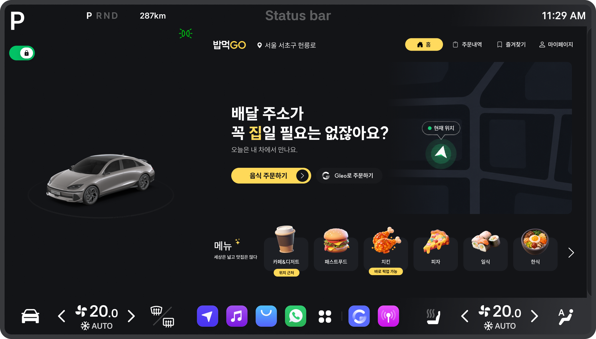
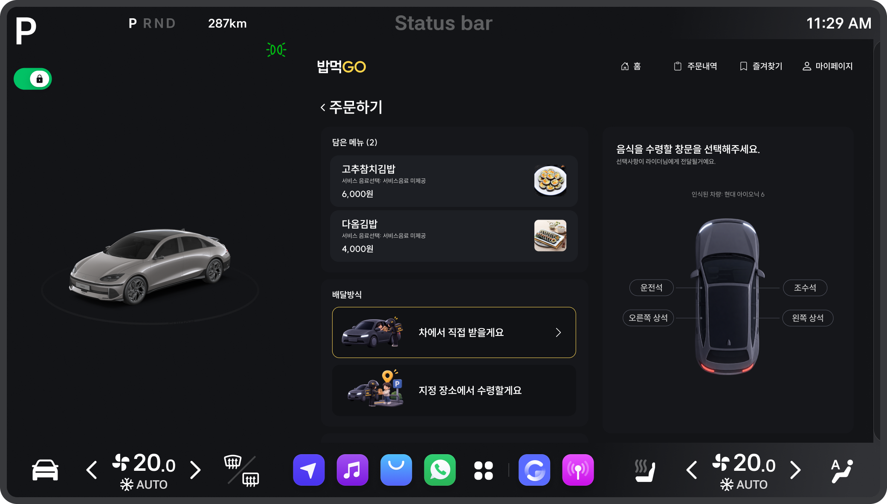
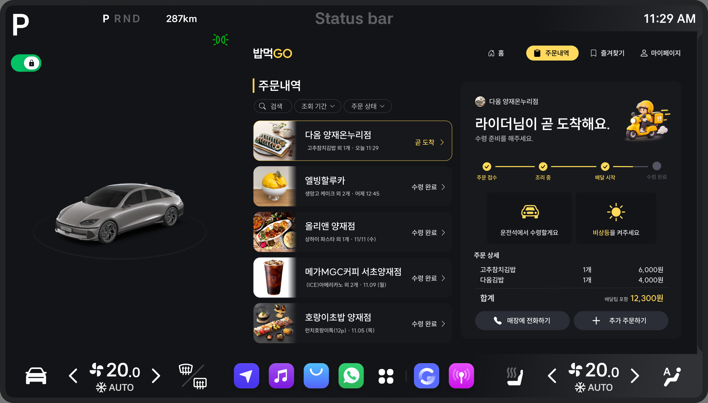

# 밥먹GO

> 주소 대신 차로 받는 배달. 세워두면 그 자리로, 달리는 중이면 가는 길 위로 배달기사가 찾아옵니다.

달리는 중엔 음성으로 주문해 가는 길 위에서, 서 있을 때는 차가 있는 그 자리에서, 차에서 내리지 않고 음식을 받는 차량용 배달 앱입니다.





| 제출물 | 위치 |
|---|---|
| APK (release) | `apk/밥먹GO_밥먹GO_release.apk` |
| 시연 영상 | [YouTube](https://www.youtube.com/watch?v=J4WBkGJTmXk) |
| PoC 근거표 | [docs/poc](docs/poc/README.md) |

## 주요 기능

| 기능 | 설명 |
|---|---|
| 🚗 차 위치 배달 | 정차 중에는 주소 입력 없이 차 위치와 차종·번호·색, 받을 창문(운전석·조수석·뒷좌석)을 배달기사에게 보냅니다. 기어가 P면 그 자리를 수령 위치로 확정합니다. 기사가 가까워지면 음성으로 알려 주고, 비상등으로 알리기를 골랐다면 비상등을 켜 달라고 안내합니다. |
| 📍 경로 위 수령 | 주행 중에는 남은 경로 위에서 수령 지점을 정해 내비 경유지로 넣습니다. 라이더는 처음부터 그 지점을 목적지로 받아 출발합니다. |
| 🙆 말로 수령 확인 | 음식을 받고 "받았어"라고 말하면 경유지를 빼고 원래 길로 다시 안내합니다. |
| 🎙️ 음성 주문 | 주행 중에는 음성 대화로 주문하고(Gleo AI에 말해도 바로 주문으로 이어집니다), 정차 중에는 차 화면으로 주문합니다. 주행 중에는 경로 근처 가게 중 지난번에 주문한 가게를 먼저 제안합니다. |
| 🔌 충전 중 주문 | 충전구가 열리고 배터리 잔량이 오르면 충전 중으로 보고, 충전이 끝나기 전에 받을 수 있는 가게를 먼저 보여 줍니다. |
| 📦 주문 진행 | 주문 접수 → 조리 중 → 배달 시작 → 곧 도착 → 배달 완료를 남은 시간과 함께 알려 줍니다. |

## 수령 지점 고르는 법

앱은 주문을 받으면 남은 경로 위의 정차 가능한 후보(공영주차장, 정차 가능 구역) 중에서 수령 지점을 정합니다. 후보마다 내비에 경로를 다시 요청해 원래 경로보다 늘어나는 거리·시간을 재고, 가장 적게 벗어나면서 음식이 준비되는 시간과 맞는 곳을 고릅니다. 고른 지점은 내비 경유지로 들어갑니다.

후보는 정차가 허용된 곳(공영주차장, 정차 가능 구역)만 쓰기 때문에, 교차로·횡단보도·버스정류장 앞처럼 정차가 금지된 곳은 수령 지점이 되지 않습니다.

사용 데이터: 외부 길찾기 경로(OSRM), Pleos 내비 경로 실측.

## 차량 데이터 활용

| 데이터 | 쓰는 곳 |
|---|---|
| 주행 중 화면 제한 (CarUxRestrictions) | 주행 중이면 음성 주문, 정차 중이면 화면 주문으로 전환 |
| 기어 (Vehicle SDK) | P일 때 차 위치를 수령 위치로 확정 |
| 현재 위치 (FusedLocation) | 정차 배달 위치, 수령 지점 근접 감지 |
| 내비 경유지 (NaviHelper) | 수령 지점 추가 → 수령 후 제거, 원래 경로로 복귀 |
| 차종 정보 (INFO_MAKE·INFO_MODEL) | 배달기사가 차를 찾도록 차종 전달 (번호·색은 사용자 등록값) |
| 음성 (Gleo AI · STT · TTS) | 주행 중 주문 대화와 안내 |
| 충전 상태 (Vehicle SDK EvBattery) | 충전구 열림과 배터리 잔량 변화로 충전 중을 알고, 충전이 끝나기 전에 받을 수 있는 가게를 먼저 보여 줌 |

## 시연 구성

- **수령 지점 후보:** 시연 경로의 수령 후보는 정차 가능한 곳으로 골라 넣었고, 앱이 지점마다 내비로 추가 거리·시간을 직접 재서 고릅니다.
- **가게·메뉴·결제·배달기사:** 시연용 데이터로 동작합니다. 실제 서비스에서는 제휴 배달앱의 가게·결제·배차를 그대로 씁니다.

## 검증 (Pleos Connect 에뮬레이터 실측)

- 경로 위 수령 지점을 경유지로 넣어도 원래 경로에서 0.5km 미만으로 벗어나고(내비가 1km 단위로 반올림), 가게에 들러 포장하면 +1km·+6분 늘어납니다. (11/12, 17km 경로)
- 기어 D에서 음성 세 마디로 주문을 끝내고, 화면 터치는 0회입니다.
- 기어 P↔D에 따라 화면 주문과 음성 주문이 자동으로 바뀝니다.
- 수령 지점 반경 100m 근접을 감지하고, 배달기사가 200m·30m 안에 들어오면 음성으로 알립니다.
- 주행 중에는 "받았어"라고 말하면 수령 완료로 보고 경유지를 빼 원래 경로로 다시 안내합니다.
- 기어 P를 받아 그 자리를 수령 위치로 확정하고, 충전구 열림·배터리 잔량 변화로 충전 중을 감지합니다.
- Gleo AI에 말하면 앱의 주문 기능이 호출되어 주문 흐름으로 이어집니다.
- 고속도로를 타는 경로에는 차를 세울 곳이 없어, 일반 도로 구간만 수령 후보로 둡니다.

자세한 기록: [docs/poc](docs/poc/README.md)

## 테스트 환경

| 항목 | 값 |
|---|---|
| 에뮬레이터 | Pleos Connect v2.1.0 (API 34) |
| 화면 규격 | 2560×1440 |
| 권한 | 설치할 때 `-g`로 위치·내비·음성 권한을 허용 |
| 데이터 | 시연 경로와 가게·메뉴 데이터는 앱에 들어 있음 |
| 인터넷 | 앱은 인터넷 권한을 쓰지 않습니다 (시연 데이터 내장, 음성 인식 온디바이스) |

## 실행 방법

release APK 설치:

```bash
adb install -r -g apk/밥먹GO_밥먹GO_release.apk
```

시연 순서와 조작 명령은 [docs/demo.md](docs/demo.md)에 있습니다.

소스에서 빌드 (서명 키 없이 디버그 빌드):

```bash
./gradlew :app:assembleDebug
```

## 기술 스택

- Kotlin · Jetpack Compose · AAOS (Android API 34)
- Pleos Connect SDK: Vehicle, NaviHelper, FusedLocation, SpeechToText / TextToSpeech, Gleo AI 앱 연동
- 경로 데이터: OSRM

## 프로젝트 구조

```
app/src/main/java/…/
├─ contract/   화면과 기능이 주고받는 상태·이벤트
├─ feature/    ViewModel, Pleos SDK 연동, 대화, 수령 지점 계산
└─ ui/         Compose 화면
```
